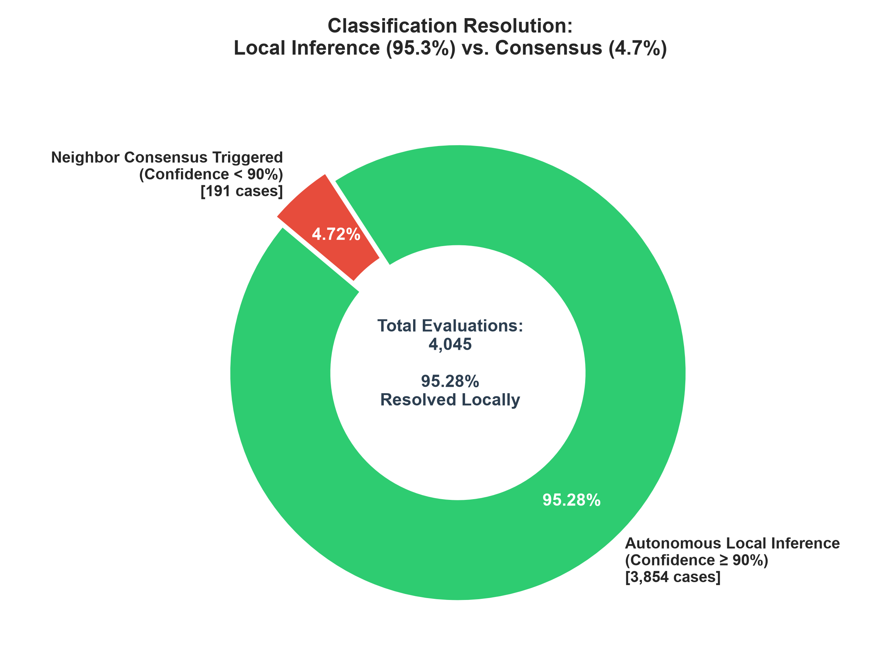
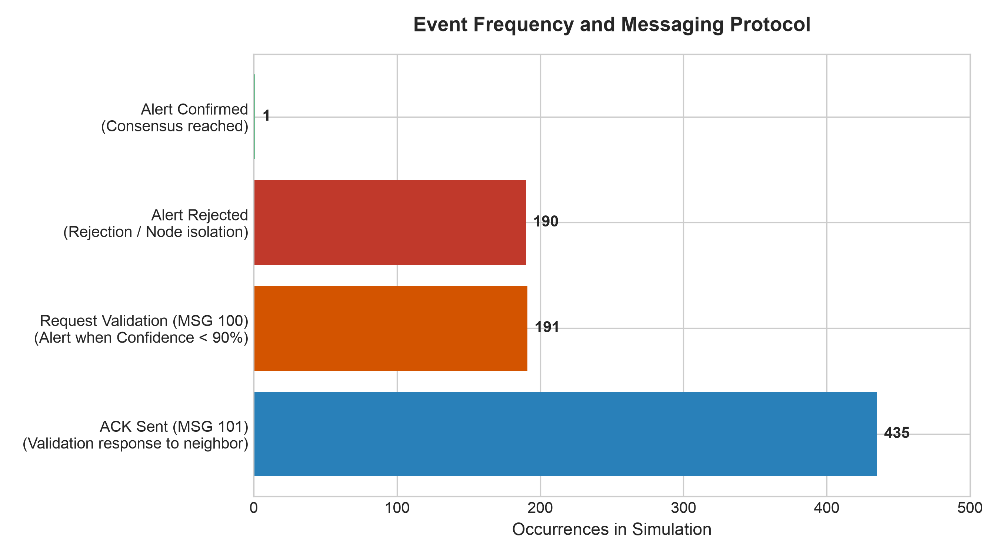
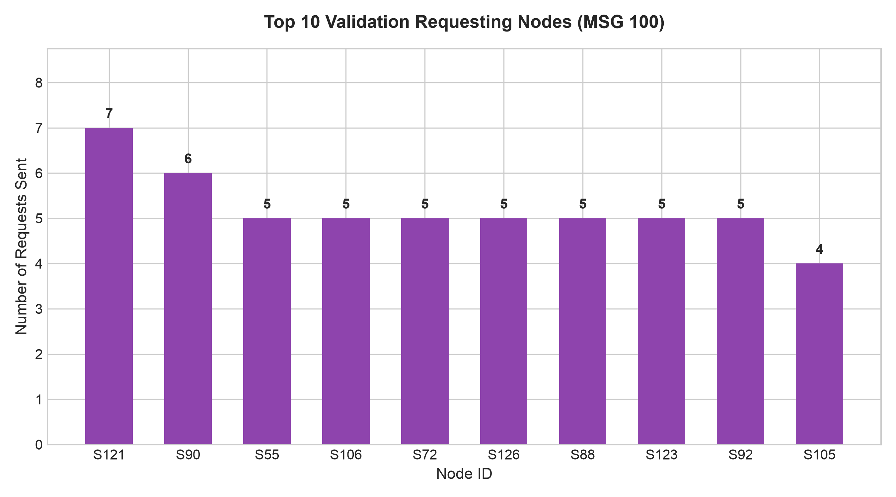
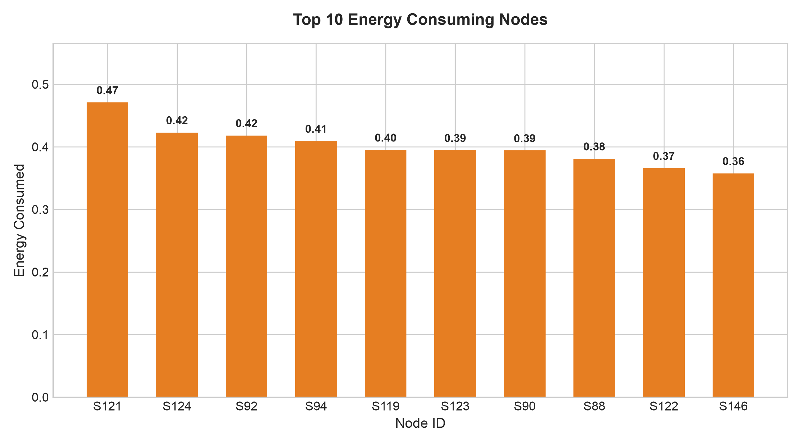
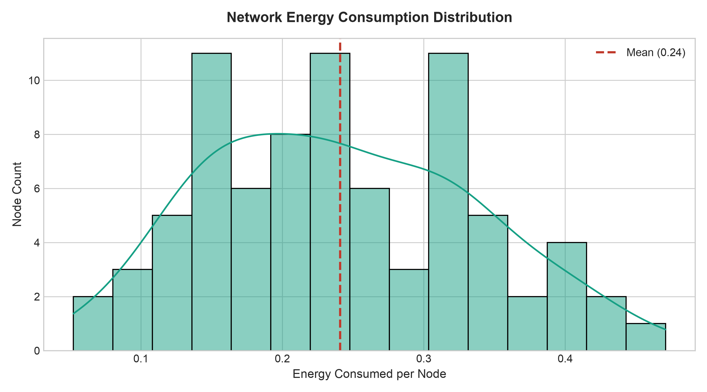

# Multilayer MAS-AIoT Water Quality Monitoring: CupCarbon P2P Simulation

Official repository for the simulation and experimental evaluation of a Peer-to-Peer (P2P) Multi-Agent System (MAS) for end-user domestic water quality monitoring in Mexico, built entirely within the **CupCarbon** simulation environment.

---

## Project Overview

This simulation models distributed consensus and communication latency among AIoT sensor agents. Using **SenScript**, edge sensor nodes perform local anomaly detection and initiate cross-validation requests (`MSG 100`) while neighbor nodes evaluate local states to return acknowledgments (`MSG 101 ACK`).

---

## Empirical Findings & Scalability Bottlenecks

Trace logs processed from CupCarbon simulations (focusing on dense deployments from nodes S52 to S114) highlighted critical constraints in flat P2P topologies:

- **Timer Desynchronization (Race Condition):** Senders enforce a static waiting window of 300 ms (`ALERTA_RECHAZADA_AISLAMIENTO`). Under high traffic load, actual neighbor processing delays average ~1,168.1 ms, triggering false isolation alerts.
- **Orphaned Packet Corruption:** Delayed ACK payloads (`MSG 101`) arrive after the sender reverts to `MONITOREO_NORMAL`, leading to invalid state transitions in the node's local Finite State Machine (FSM).
- **Medium Contention:** Channel contention and stochastic delays (`RANDB`) in the simulated wireless environment demonstrate that flat P2P consensus requires adaptive timing before scaling to larger urban municipal networks.

---

## Repository Structure

```text
.
├── assets/                  # Generated figures, charts, and energy summaries
├── config/                  # CupCarbon configuration settings
├── gps/                     # Spatial node coordinates and GPS mapping
├── logs/                    # Simulation execution traces and console output
├── natevents/               # Environmental event injection scenarios
├── network/                 # CupCarbon network topology files (.net)
├── results/                 # Raw simulation metric outputs and performance data
├── scripts/                 # SenScript behavioral routines for sensor agents
├── tmp/                     # Temporary simulation runtime cache
├── xbee/                    # XBee communication layer configurations
├── generar_assets.py        # Script to parse logs/CSVs and regenerate all visuals
├── LoRaP2PSimulation.cup    # Main CupCarbon project file
└── README.md                # Repository documentation
```

---

## Execution Guide

### Prerequisites
- **CupCarbon Simulator:** Version 5.2 or higher (Java JRE 11+ required).
- **Python 3.10+:** Required for running log parsers and generating asset charts.

### Steps
1. **Clone this repository:**
   ```bash
   git clone https://github.com/your-username/your-repo-name.git
   cd your-repo-name
   ```
2. **Run Simulation:**
   - Launch CupCarbon, navigate to `File > Open Project`, and select `LoRaP2PSimulation.cup`.
   - Verify that topology configurations in `/network` correctly reference the SenScript routines stored in `/scripts`.
   - Run the simulation. Execution logs will automatically populate in `/logs` and numerical results in `/results`.
3. **Generate Assets & Energy Summaries:**
   ```bash
   python generar_assets.py log.txt wisen_simulation.csv
   ```

---

## Results & Performance Evaluation

### Executive Summary & Local Inference vs. Consensus

- **Total Network Evaluations:** 4,045
- **Resolved via Local Inference ($\ge 90\%$ Confidence):** 3,854 cases (**95.28%**)
- **Triggered Neighbor Consensus ($< 90\%$ Confidence):** 191 cases (**4.72%**)

The network architecture offloads **95.28%** of classification decisions to local edge nodes, significantly reducing network traffic and reserving neighbor consensus exclusively for low-confidence detections.



---

### Protocol Messaging & Event Breakdown

Analysis of SenScript state execution and message exchanges across the network:

- **ACK Sent (`MSG 101`):** 435 neighbor validation responses.
- **Validation Requests (`MSG 100`):** 191 consensus initiation messages triggered when local confidence fell below 90%.
- **Alert Rejected / Isolation:** 190 instances where consensus timed out before reaching quorum.
- **Alert Confirmed:** 1 instance of multi-node consensus confirmation.



---

### Top Validation Requesting Nodes

Identification of sensor nodes generating the highest volume of validation requests (`MSG 100`) due to borderline confidence scores:



---

### Energy Consumption Metrics

Energy analysis evaluated node battery depletion over the simulation run. By resolving **95.28%** of anomaly checks locally, nodes avoid frequent radio transmissions, preserving battery power across the network.

#### Top Energy Consuming Nodes
The nodes consuming the highest amount of energy correlate with increased communication activities (consensus request handling and message relaying):



#### Network Energy Distribution
Overall energy consumption distribution across all sensor nodes in the network:



> **Note:** Detailed per-node energy breakdown is saved to `assets/energy_summary.csv`.

---

## I/O Automata & FSM Behavior

Each sensor agent operates as an I/O automaton governed by SenScript logic executing a closed-loop monitoring cycle:

```
       ┌────────────────────────┐
       │   MONITOREO_NORMAL     │◀──────────────────────────┐
       └───────────┬────────────┘                           │
                   │ Local Confidence < 90%                 │
                   ▼                                        │
       ┌────────────────────────┐                           │
       │ SOLICITA_VALIDACION    │                           │
       │ (Broadcast MSG 100)    │                           │
       └───────────┬────────────┘                           │
                   │ Static 300 ms Timer                    │
         ┌─────────┴──────────┐                             │
         ▼                    ▼                             │
┌────────────────┐   ┌────────────────┐                     │
│ ACK Received   │   │ Timeout        │                     │
│ (MSG 101)      │   │ (> 300 ms)     │                     │
└───────┬────────┘   └───────┬────────┘                     │
        │                    │                              │
        ▼                    ▼                              │
┌───────────────┐   ┌────────────────┐                      │
│   ALERTA      │   │   ALERTA       │                      │
│ CONFIRMADA    │   │  RECHAZADA     │──────────────────────┘
└───────────────┘   └────────────────┘ (Return to Monitoreo)
```

1. **State `MONITOREO_NORMAL` (NORMAL MONITORING):** Nodes sample local sensors and evaluate anomaly confidence. If confidence is $\ge 90\%$, classification completes locally without network I/O.
2. **State `SOLICITA_VALIDACION_VECINO` (REQUEST NEIGHBOR VALIDATION):** If confidence drops below $90\%$, the node broadcasts `MSG 100` and starts a 300 ms response timer.
3. **Neighbor Processing & Acknowledgment:** Adjacent nodes receiving `MSG 100` cross-examine their sensor state and reply with `MSG 101` (ACK).
4. **State Transition & Resolution:**
   - **Success:** If sufficient ACKs arrive within 300 ms, the node transitions to `ALERTA_CONFIRMADA_POR_VECINO` (ALERT CONFIRMED BY NEIGHBOR).
   - **Timeout/Isolation:** If latency exceeds 300 ms due to medium contention, the node transitions to `ALERTA_RECHAZADA_AISLAMIENTO` (REJECTED_ALERT_ISOLATION) and reverts to normal monitoring.

---

## Scalability & Optimization Opportunities
1. **Dynamic Adaptive Timers:** Replace static 300 ms timeout windows with dynamic Round-Trip Time (RTT) estimation to accommodate MAC-layer contention delays.
2. **Clustered MAS Architecture:** Transition from a flat P2P topology to a hierarchical Cluster Head (CH) structure to eliminate channel saturation in high-density urban deployments.
3. **Sequence Numbering & Epoch Tracking:** Include transaction IDs in consensus messages to reject late-arriving orphan ACKs (`MSG 101`) and prevent FSM corruption.
4. **Energy-Balanced Consensus Routing:** Prioritize consensus validation pathways through nodes with higher remaining energy levels to extend overall network longevity.